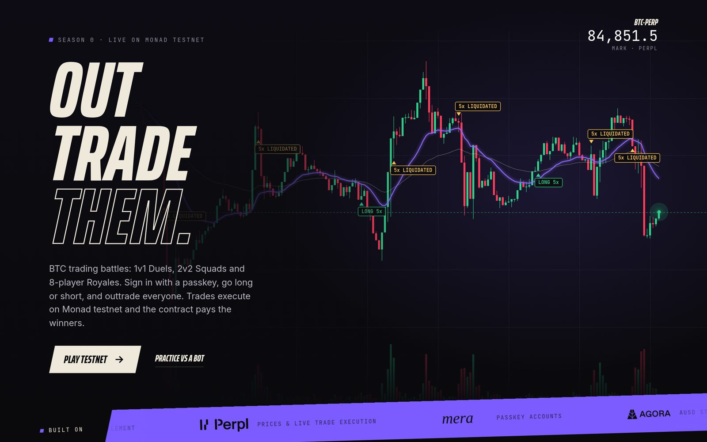
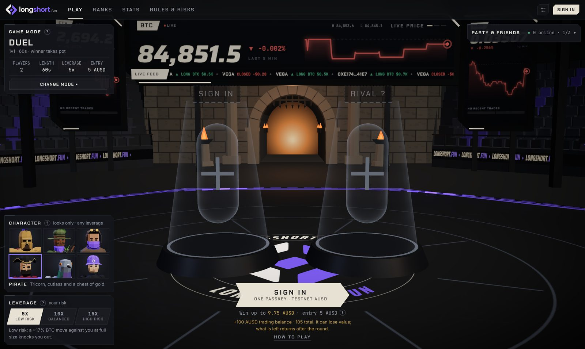
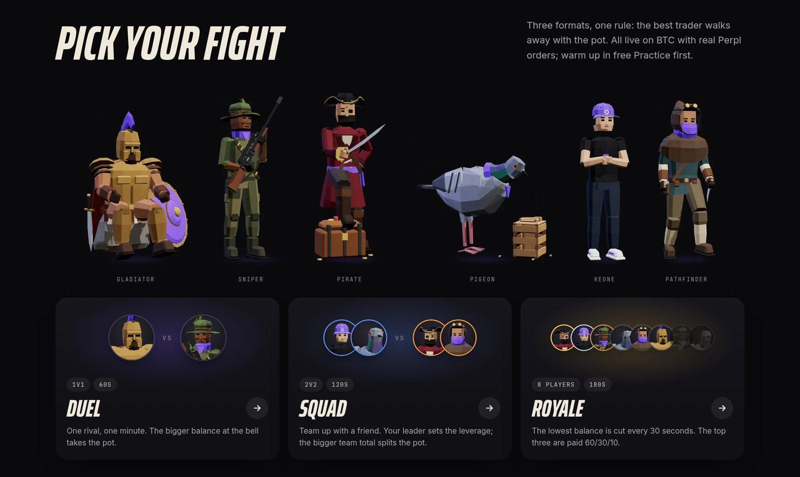

# longshort.fun

**PvP Bitcoin trading battles on Monad.** Pick a fighter and a leverage, then outtrade a rival before the bell. Every Long, Short and Close is a real order on [Perpl](https://perpl.xyz)'s onchain order book. Players sign in with a passkey, hold no MON, never sign up on Perpl and never see a wallet pop-up.



- **Live app:** [longshort.fun](https://longshort.fun), a private preview during judging. The access code is in our submission.
- **Network:** Monad testnet, chain 10143. Test AUSD only; nothing here has monetary value.
- **Formats:** Duel 1v1 · 60 s, Squad 2v2 · 120 s, Royale 8 players · 180 s, all on BTC-PERP at 5×, 10× or 15×.
- **Contracts:** PerplArena [`0x5Efae318…`](https://testnet.monadscan.com/address/0x5Efae3185739539E28FedcA99118C6D4EC9B2C1A) · RelayDelegate [`0xcd68DAB8…`](https://testnet.monadscan.com/address/0xcd68DAB8dFFC21C39B671a90D86D7A6E2d693513) · AUSD [`0xa9012a05…`](https://testnet.monadscan.com/address/0xa9012a055bd4e0eDfF8Ce09f960291C09D5322dC) · Perpl [`0x1964C32f…`](https://testnet.monadscan.com/address/0x1964C32f0bE608E7D29302AFF5E61268E72080cc)
- **Built for:** [Monad Metropolis](https://monad.xyz/metropolis)

**Contents:** [The game](#the-game) · [Try it](#try-it-in-three-minutes) · [Real trades on Perpl](#real-perpl-trades-without-a-perpl-account) · [Gasless with EIP-7702](#no-gas-no-pop-ups-eip-7702-sponsorship) · [Who pays which fee](#who-pays-which-fee) · [Passkeys](#passkey-accounts-with-mera) · [Why Monad](#why-monad) · [Settlement and trust](#settlement-and-trust) · [A recorded match](#a-recorded-match) · [Architecture](#architecture) · [Limitations](#limitations) · [Run it](#verify-and-run-locally)

## The game

- **Three formats, one rule.** The bigger trading balance at the bell takes the pot. In a **Duel** that is one rival over 60 seconds. In a **Squad** two teams of two add up their balances over 120 seconds, and the leader's leverage applies to the whole team. In a **Royale** eight players trade for 180 seconds while the lowest balance is cut every 30 seconds; the top three are paid 60/30/10.
- **Two separate amounts.** Each player puts in an entry (5, 20 or 50 AUSD) that forms the pot, plus a 100 AUSD trading budget that trades on Perpl and comes back after the round, whatever is left of it.
- **Leverage is the risk choice; the character is the look.** Leverage is 5×, 10× or 15× (15× is Perpl's BTC maximum), labelled low, balanced and high risk. Six low-poly characters (Gladiator, Sniper, Pathfinder, Pirate, Pigeon and Keone) are cosmetic: any character plays at any leverage, in the 3D arena and on the share card.
- **A report after every round** links each transaction, and an optional private journal keeps your thesis beside it, encrypted with a key derived from your passkey.
- **Practice** is free and needs no account: live BTC prices, simulated positions in the browser, against a bot.

<p>
  
  
</p>

## Try it in three minutes

1. Open [longshort.fun](https://longshort.fun) and enter the access code from our submission.
2. Press **Play testnet** and create a passkey (Face ID, Touch ID or a device PIN) through Mera. If the device has no passkey support, choose **Play as a guest**: a wallet kept in that browser, with its key exportable from the account menu.
3. Keep the suggested name or type your own, then press **Claim 200 AUSD** to receive test AUSD for entries and trading. Rivals see the name, never an address.
4. Pick **Duel**, a 5 AUSD entry, a character and a leverage. Playing alone? A labelled bot takes the empty seat after about 12 seconds (**Match with bots** in Settings, on by default).
5. After the 15-second countdown, trade with **Long**, **Short** and **Close** at 25%, 50% or 100% size. No prompt appears: each click is a sponsored onchain transaction, and the **Ping** meter shows its measured confirmation time.
6. At the bell, open positions are flattened on Perpl, the pot is paid and your remaining trading capital returns to your account. The report links every transaction.

## Real Perpl trades without a Perpl account

A player never visits Perpl, signs up or deposits. The arena opens a Perpl account for each player, for one match, and closes it out afterwards.

1. **Join.** `PerplArena.joinMatch` pulls the entry and the 100 AUSD budget from the player in one transfer, then deploys a `MatchTradingAccount` for that player and match as an [EIP-1167](https://eips.ethereum.org/EIPS/eip-1167) minimal-proxy clone. The clone receives the budget and calls Perpl's `createAccount(100 AUSD)`. The result is a fresh Perpl account owned by the contract, whose only beneficiary is the player.
2. **Trade.** Long or Short calls `PerplArena.open`, which calls the clone, which calls Perpl's `execOrder`. The order size is the trading balance × leverage × chosen size × 95% (headroom for fees) ÷ the mark price. The order is immediate-or-cancel and limited to the mark ±1%; an opening order is also fill-or-kill. In the same transaction the clone checks that Perpl filled every lot, because Perpl can reject an order inside a successful transaction.
3. **Close and flip.** A close is reduce-only and immediate-or-cancel, so a retry can never flip the position or leave a resting order. Flipping from long to short closes and reopens in one transaction.
4. **Liquidation** is Perpl's own; the arena records that the position is gone and the player is out.

The clone has no general `call`, no operator withdrawal and no deposit path. Only the arena can trade it, and collateral can only leave to the player.

## No gas, no pop-ups: EIP-7702 sponsorship

Passkey and guest accounts are ordinary secp256k1 EOAs holding 0 MON. Each one delegates its code to [`RelayDelegate`](contracts/src/RelayDelegate.sol) with [EIP-7702](https://eips.ethereum.org/EIPS/eip-7702), and the keeper's relayer pays the gas.

1. **The browser signs twice, silently.** It signs an EIP-712 `Execute(target, data, nonce, deadline)` whose verifying contract is the account itself. On the account's first sponsored call it also signs an EIP-7702 authorization pointing its code at `RelayDelegate`.
2. **The relayer submits.** The keeper verifies both signatures, simulates the call and sends a transaction to the player's own address calling `execute(...)`. That is a type `0x04` transaction carrying the authorization when the account is not yet delegated, and an ordinary transaction afterwards. The relayer pays the MON.
3. **The account runs the delegate.** `RelayDelegate` checks the deadline and the allowlist, requires the signature to recover to the account itself, and increments a nonce stored on the account. Then it calls the arena, so the arena sees the player as `msg.sender`.

The delegate forwards only arena gameplay (`createMatch`, `joinMatch`, `leave`, `open`, `close`, `setClass`, `recover`) and an AUSD `approve` whose spender is the arena. The sponsor cannot move a player's AUSD or MON.

**Monad-specific handling in the relayer** ([relay.ts](keeper/src/relay.ts)):

- **Gas is billed on the gas limit, including for reverts.** The relayer simulates every call, sends it with a 20% buffer and refuses anything above 2,000,000 gas. It rate-limits each account (90 calls per 10 minutes) and each IP (360 per 10 minutes) so a failing loop cannot drain the sponsor.
- **Reserve balance.** Monad reverts any transaction that would take a delegated EOA below 10 MON. `RelayDelegate` never moves MON, so delegated player accounts work at a balance of 0. The sponsor sends constantly and cannot use Monad's emptying exception, so the relayer keeps 10 MON plus the worst-case cost of in-flight transactions in reserve.
- **Durable submission.** The signed transaction and its hash are written to SQLite before the first broadcast. A restart rebroadcasts the same bytes instead of spending a second nonce.

### Who pays which fee

| Fee | Paid by | How |
| --- | --- | --- |
| Network gas (MON) | the longshort relayer | EIP-7702 relay above. Players hold no MON. |
| Perpl trading fees | the player's 100 AUSD trading budget | Perpl's own fees on each fill. The arena charges no trading fee (`feeBps = 0`) and reports what each fill cost. |
| Arena rake | the prize pot | 2.5% of the entries. Ties refund every entry with no rake. |

## Passkey accounts with Mera

[Mera](https://github.com/category-labs/mera) by Category Labs turns a passkey into signing keys without a smart-account contract or a custody service ([details](docs/MERA.md)).

- **One passkey, separate keys.** The passkey's PRF output goes through HKDF to derive an **owner** key and a trade root, and from the trade root one **match key** per match. The keys live only in memory as Mera signing sessions and are cleared on lock, after 30 idle minutes, or when the page closes.
- **One prompt per entry.** The owner holds AUSD, approves exactly the entry plus the trading budget, joins, and registers that match's key as the player's `session`. During the round the match key signs every trade without another prompt. A session key cannot move the stake or redirect collateral.
- **Recovery without stored secrets.** The match key's public derivation label is saved before entry and checked against the session registered onchain, so a new browser with the same passkey recovers an open round.

## Why Monad

- **Speed that a 60-second game needs.** Monad produces a block every 300 ms and reaches finality in about 600 ms. A Duel spans roughly 200 blocks, so every Long, Short and Close can be its own transaction and still confirm while the price matters.
- **EIP-7702 on a fast L1.** Type `0x04` transactions let a plain EOA run a small, allowlisted delegate contract, so passkey accounts trade gaslessly without deploying a smart wallet per player.
- **A fully onchain perpetuals order book on the same chain.** Perpl matches and settles on Monad, so a Solidity contract can open, verify, close and settle real positions atomically, contract to contract, with no off-chain broker or API keys.
- **Standard EVM tooling, with Monad's rules respected.** The contracts use Solidity 0.8.28, Foundry and OpenZeppelin (`Clones`, `SafeERC20`, `ReentrancyGuard`), viem runs in the browser and the keeper, and Envio indexes history. The relayer applies Monad's gas-limit billing and reserve-balance rules described above.

## Settlement and trust

- **Settling is permissionless.** At the bell anyone can call `settle`; the keeper does it on time. The arena enters `CLOSING`, flattens every account (one stuck account cannot block the others, and closes are retried), and reaches `SETTLED` only when every account is flat. It ranks players by their final Perpl balances read onchain, pays the pot from escrow and returns each player's remaining collateral to that player.
- **Royale cuts are permissionless too.** `eliminate` can be called by anyone at each 30-second boundary.
- **If the keeper disappears**, a stuck round can still be settled, cancelled after its timeout, or recovered by the player, and collateral only ever goes to its owner. The contract owner's `emergencyCancel` works only before trading starts and only refunds.
- **What the keeper does:** matchmaking, parties, the live price stream, labelled bots and gas sponsorship. It cannot invent fills or results: scoring reads Perpl balances onchain.

## A recorded match

Match #2 on the live arena: a passkey player at 15× against a keeper bot at 10×.

| Step | Transaction |
| --- | --- |
| Entry, sponsored | [`0xf95bd783…`](https://testnet.monadscan.com/tx/0xf95bd783c053083f5c9af7d0ef4f6990aeb96c7575bdd9333eb68096000032d6) |
| First trade: a brand-new match key delegates through EIP-7702 and opens a 15× BTC long in the same type `0x04` transaction | [`0x25140735…`](https://testnet.monadscan.com/tx/0x25140735bd614af7b2ab0248b106f9fe8fa60e422368c797f4b3c34ee15bb775) |
| Settlement: positions flattened, pot paid, collateral returned | [`0xdbfe23af…`](https://testnet.monadscan.com/tx/0xdbfe23af0abcea7181103e41bcdeba034bfa101ab680ca2fa0722f606b0f3ea1) |

The long filled 0.0084 BTC (712.15 AUSD notional) at 84,779.3, with a Perpl fee of 0.245691 AUSD. The passkey player won the 9.75 AUSD prize and received 99.505259 AUSD of trading capital back; the bot received 99.120832 AUSD.

## Architecture

```text
browser: Next.js, viem, Mera passkeys, three.js arena
  │  EIP-712 + EIP-7702 signatures (owner key, per-match key)
  ▼
keeper: matchmaking, live prices, bots, relayer, SQLite
  │  sponsored transactions, settlement calls
  ▼
Monad testnet
  ├─ RelayDelegate: delegate code for player EOAs (allowlisted arena calls)
  ├─ PerplArena: entry escrow, rounds, Royale cuts, ranking, payouts
  ├─ MatchTradingAccount: one clone per player and match, owns a Perpl account
  ├─ Perpl: BTC-PERP orders, fills, liquidations, collateral
  └─ AUSD: entries, trading budgets, prizes, returned collateral
       │  events
       ▼
Envio HyperIndex → GraphQL → profiles, ranks, stats, match reports
```

### Prize math

The pot is every entry added together, minus the 2.5% rake. A 5 AUSD entry needs 105 AUSD in the wallet: 5 for the pot and 100 for trading.

| Mode | Winner | Pays at 5 AUSD entry |
| --- | --- | --- |
| Duel | bigger final balance | 9.75 AUSD |
| Squad | bigger summed team balance, split equally | 9.75 AUSD to each winner |
| Royale | survivors by final balance, then later cuts rank higher; top three paid 60/30/10 | 23.40 / 11.70 / 3.90 AUSD |

The full disclosure is on the site's Rules & Risks page.

### Built with

| | Used for | Notes |
| --- | --- | --- |
| [Perpl](https://perpl.xyz) | Every live trade, fill, liquidation and final balance | Above, and [MatchTradingAccount.sol](contracts/src/MatchTradingAccount.sol) |
| [Agora AUSD](https://www.agora.finance) | Wallet balance, entries, trading collateral, prizes | [docs/AGORAUSD.md](docs/AGORAUSD.md) |
| [Mera](https://github.com/category-labs/mera) | Passkey accounts and per-match signing sessions | [docs/MERA.md](docs/MERA.md) |
| [Envio](https://envio.dev) | Match history, fills, rankings and statistics | [docs/ENVIO.md](docs/ENVIO.md) |

## Limitations

- **Testnet only.** It runs on Monad testnet with test AUSD and Perpl's testnet market. Prices and liquidity can differ from mainnet BTC.
- **Taker orders on a real book.** Orders cross the book within ±1% of the mark. If Perpl's testnet book cannot fill an opening order completely, the order is rejected and the player can try again; the round carries on.
- **One market, one position.** BTC-PERP only, one position per player at a time, sized at 25%, 50% or 100% of the trading balance times leverage. Leverage tops out at Perpl's BTC limit of 15×.
- **A central coordinator.** The keeper runs matchmaking, the price stream, bots and gas sponsorship. If it is offline no new rounds start and sponsored trades stop, although settlement and recovery stay permissionless.
- **Sponsored gas has limits.** Rate limits and a per-call gas cap apply, and relayed actions pause if the sponsor wallet runs low.
- **Passkeys need PRF support.** Without it, the guest wallet keeps its key in browser storage, which is weaker than a passkey. Passkeys are not verified onchain (Monad's P-256 precompile is not used): Mera derives the keys in the browser, and there is no social recovery if a passkey is lost.
- **Royale needs eight players.** Empty seats fill with labelled bots unless **Match with bots** is turned off.
- **Practice is a simulation** in the browser on live prices, not an onchain round.
- **Private preview.** During judging every page, shared result and API needs the access code.

## Verify and run locally

The local stack is a self-contained sandbox: anvil, test USD, virtual margin at 10x/25x/50x and a mock oracle the keeper fills with live Perpl BTC prices. It needs no keys and no testnet funds. longshort.fun runs the real-Perpl profile on Monad testnet. Requirements: Node 22+, npm and [Foundry](https://getfoundry.sh).

```bash
git clone https://github.com/dun999/longshort && cd longshort
npm install
(cd contracts && forge install --no-git foundry-rs/forge-std@v1.16.2 OpenZeppelin/openzeppelin-contracts@v5.7.0)
npm run use:local                          # local address profile
npm run dev:chain                          # terminal 1: anvil on :8545
npm run contracts:build && npm run deploy:local
cp keeper/.env.example keeper/.env         # anvil keys, access gate open
cp web/.env.example web/.env.local
npm run keeper                             # terminal 2: API on :8787
npm run web                                # terminal 3: http://localhost:3000
```

Open `http://localhost:3000/play`, choose **Sign in → Quick guest** (funded with 200 tUSD), pick a name, then press **Play**. A labelled bot takes the empty seat after 12 seconds; the keeper funds its bots during its first minute or two (log line `bots funded & approved`).

- `use:local` and `deploy:local` rewrite `packages/shared/src/addresses.json`; `git checkout packages/shared/src/addresses.json` restores the live profile.
- After restarting anvil, run `deploy:local` again and delete `keeper/longshort.db`.
- Match reports and history read the Envio indexer (`indexer/`); without it those pages stay empty and the game itself still works.

Tests:

```bash
npm -w keeper test        # 51 tests: matchmaking, relay, claims, recovery, access gate
npm -w web test           # 28 tests: Mera keys, live accounts, journal, Envio reports, access gate
npm run contracts:test    # 73 Foundry tests; 3 Perpl fork tests also run when PERPL_FORK_RPC is set
npm -w keeper run typecheck
node_modules/.bin/tsc --noEmit -p web/tsconfig.json
```

The live deployment is recorded in [addresses.json](packages/shared/src/addresses.json). Secrets and signing keys stay in ignored environment files.

| Path | What it holds |
| --- | --- |
| `contracts/` | `PerplArena`, `MatchTradingAccount`, `RelayDelegate`, the legacy `ArenaCore` and Foundry tests |
| `keeper/` | Matchmaking, parties, price delivery, bots, AUSD claims, relayer, settlement, SQLite |
| `indexer/` | Envio handlers and schema for the arena, Perpl fills and AUSD transfers |
| `web/` | Next.js app, the three.js arena, trading HUD, accounts, reports; `web/art/cast` builds the characters in Blender |
| `packages/shared/` | Deployment addresses, ABIs, relay rules, game constants, the character list |
