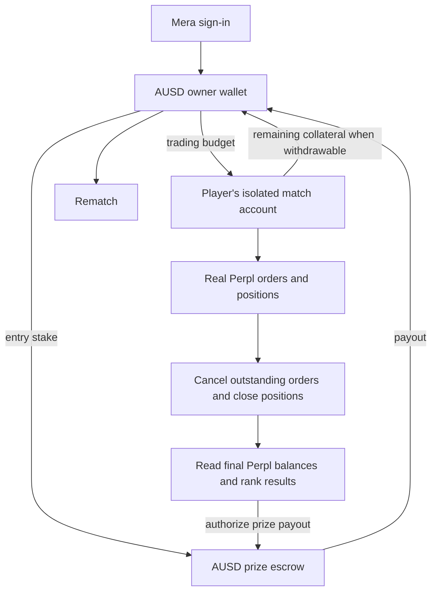

# AUSD main loop and Agora bounty plan

Planning date: 1 October 2026. This is an implementation plan; it does not change the running product or deploy contracts.

## Objective and requirements

Make AUSD the wallet balance, entry stake, live trading collateral, and payout asset in longshort.fun's primary mobile play flow.

The user supplied the bounty's eligibility text: the mobile application must authenticate through Mera, hold and display AUSD, and execute trades through Perpl. Judging considers implementation quality, user experience, and creative use of the three integrations together.

The proposed product is a 60-second duel in which a Mera account commits an AUSD entry and a separate AUSD trading budget, executes real Perpl positions, and receives its remaining trading capital plus any AUSD prize. A rematch reuses the returned capital.

The first release targets Monad testnet. The supplied requirements do not specify mainnet or native distribution. Plan an installable mobile web app using the existing Next.js application; verify whether the organizer requires native packaging before making packaging commitments.

## Current implementation

| Area | What exists | Required change |
| --- | --- | --- |
| Authentication | `web/src/lib/mera.ts` derives an owner and match trading keys through Mera. | Make this the primary bounty onboarding path and validate it on phones. |
| AUSD | A separate AUSD arena is configured in `addresses.testnet-ausd.json`; the selected `addresses.json` uses the tUSD arena. | Make the new live AUSD deployment the default across web and keeper. |
| Trading | `ArenaCore.open/close` operate virtual positions with a fixed $1,000 virtual starting margin. The Perpl interface currently exposes only price reads. | Execute real Perpl orders and derive positions, fees, liquidations, and results from Perpl state. |
| Gas | The selected tUSD deployment has an EIP-7702 delegate. The AUSD profile has none. | Deploy a delegate for the new arena, measure its gas needs, and migrate known previous delegations. |
| History | Envio indexes both existing arenas, but trader and global aggregates combine their monetary results. | Track the new arena and real Perpl fills with explicit asset and arena identity. |
| Mobile | Responsive HUD, safe areas, Mera, and wake lock exist. | Add installability and verify passkeys, trading, recovery, and reconnects on actual devices. |

The current price-only Perpl integration does not meet the supplied requirement to execute trades through Perpl. Selecting the existing AUSD profile would complete only part of the work.

## Verified protocol facts

- Agora lists testnet AUSD at `0xa9012a055bd4e0eDfF8Ce09f960291C09D5322dC` and its faucet at `0xd236c18D274E54FAccC3dd9DDA4b27965a73ee6C`.
- The live Perpl testnet public context, checked on the planning date, reports chain `10143`, exchange `0x1964C32f0bE608E7D29302AFF5E61268E72080cc`, the same AUSD collateral, and 6 decimals.
- It reports `min_account_open_amount = 100000000`, or **100 AUSD**, and a minimum subsequent deposit of 10 AUSD. Read these limits during setup rather than hard-coding them.
- The current mainnet context reports a 10 AUSD opening minimum. Mainnet is a separate deployment with different market IDs.
- Perpl supports contract-owned exchange accounts and separates trading operators from withdrawal owners in its reference delegated-account implementation.
- Direct onchain trading is supported. The API route requires API-key enrollment, integration-origin whitelisting, and onchain order-forwarding authorization.
- Some reference interfaces and older documentation lag the exchange revision. Establish the current callable order and account interfaces against the deployed exchange before coding the adapter.

Sources: [Agora deployments](https://docs.agora.finance/developer/contract-deployments), [Perpl network configuration](https://github.com/PerplFoundation/perpl-docs/blob/main/docs/resources/for-developers/networks-and-configuration.md), [live testnet context](https://testnet.perpl.xyz/api/v1/pub/context), [contract-owned accounts](https://github.com/PerplFoundation/delegated-account), and [API integration requirements](https://github.com/PerplFoundation/api-docs/blob/main/integrations.md).

## Recommended architecture

Build a new `PerplArena` coordinator and a small `MatchTradingAccount` for each player in each match. Reuse the existing UI, Mera integration, matchmaking patterns, and relay transport. The existing deployed `ArenaCore` cannot acquire a new execution and settlement model through a configuration change.

The coordinator holds only entry stakes. Each trading account holds its own Perpl collateral and binds its beneficiary, coordinator, match, market, and starting budget. Mera-derived session keys can request permitted trades through the coordinator during the round. They cannot redirect withdrawals, increase the agreed budget, or trade outside the permitted round. The beneficiary retains a recovery path for remaining collateral.

Use direct contract calls for the first version. The coordinator routes to the isolated account, which calls Perpl's verified current order interface. This preserves the existing sponsored, signed transaction model and avoids dependence on API-origin approval. Do not enable an alternate forwarding path that bypasses match restrictions. An unrestricted delegated account alone does not enforce match timing or budgets.

Use minimal account clones if gas measurements justify them. The reference delegated-account contracts establish protocol compatibility; using their full upgradeable architecture is not required for this plan.

### Money and scoring

For an illustrative testnet duel, each player commits **5 AUSD entry + 100 AUSD trading budget**. The entry pot is 10 AUSD; a 2.5% rake leaves a 9.75 AUSD winner payout. The trading accounts' remaining collateral belongs to their respective players and is separate from that prize.

Score the change from equal starting trading budgets to final, flat Perpl balances, including actual execution fees and funding. Prevent deposits, withdrawals, unrelated markets, and outside trading from changing the match balance while the round is active. If budgets differ in a later version, specify normalization before supporting that case.

Real trading introduces losses to the trading budget. Update the current claim that the entry is the maximum loss. Show the entry, trading exposure, protocol fees, and prize separately before joining. Confirm bounded exposure in the protocol spike and contract tests.

### Match lifecycle

`OPEN → COUNTDOWN → LIVE → CLOSING → SETTLED`, with cancellation and recovery paths.

At the timer expiry, stop new exposure, cancel pending orders, and submit closes bounded to the actual remaining position. Keep the match in `CLOSING` while fills or cancellations are incomplete. Only settle the prize after onchain reads prove that accounts have no remaining positions or order locks. A successful transaction or accepted order is not sufficient proof of a completed fill.

Allow closing and settlement to continue when a player disconnects. Define bounded retry, stale-feed, exchange-halt, and refund behavior. A cancelled contest can refund entry stakes; it cannot undo actual trading losses. Remaining collateral recovery must remain available if prize settlement or withdrawals are temporarily blocked.

## Sequenced implementation

### 1. Prove Perpl execution before rebuilding the arena

Create a small integration harness on a Monad testnet fork. Verify current order selectors, contract account creation, AUSD deposits, order sizing, fills, close behavior, balance accounting, withdrawal limits, and liquidation behavior. Prove that a contract-owned account can open and close BTC and recover collateral.

Measure gas for creation, funding, opening, flipping, and closing. The current relay caps requests at 800,000 gas, so account setup may need batching or a justified revised cap. Inspect actual order outcomes, not only receipt success.

Checkpoint: a reproducible protocol trace and accurate ABI/accounting model. Do not proceed with the settlement design if isolated account execution is unavailable.

### 2. Implement real AUSD duel contracts

Add `contracts/src/PerplArena.sol`, `contracts/src/MatchTradingAccount.sol`, and a complete, narrowly scoped Perpl interface. Keep the original virtual math available for Practice.

Implement entry escrow, equal trading budgets, session authorization, market and sizing restrictions, actual execution, `CLOSING`, final balance snapshots, prize ranking, payouts, ties, and entry refunds. Publish account IDs and final balance snapshots in events so results can be independently inspected.

Start with **Duel + BTC** and a modest leverage preset verified against current Perpl limits. Add ETH/MON, leverage classes, Squad, and Royale after this flow passes. The first real mode cannot continue using the old virtual fee and liquidation rules.

Checkpoint: two isolated accounts complete a real Perpl duel; settlement redistributes exactly the entry pot, while returning or making recoverable each player's own remaining collateral.

### 3. Wire deployment, AUSD funding, and sponsored gas

Update `packages/shared/src/chains.ts`, deployment profiles, generated ABIs, deployment scripts, `contracts/src/RelayDelegate.sol`, shared relay rules, and the web/keeper relay paths.

Deploy fresh contracts for the new execution model and a delegate bound to that arena/AUSD pair. Keep relay permissions limited to the new coordinator and its AUSD approval. Known owners already delegated to the tUSD relay need an explicit migration path; preserve their EOA execution nonce and reject unknown delegation targets.

Preflight chain ID, token decimals, arena token, exchange collateral, delegate bindings, and contract code before opening matchmaking. Fund the testnet demo from the official faucet or a provisioned AUSD balance. Size player drips and bot funding for both the entry and real trading budget; disable bot-only ambient matches initially.

Use a separate keeper database for the new arena. The current indexer resets cached match data and profile aggregates on an arena change; do not point it at the old database as an unreviewed migration. Complete existing matches before retiring their keeper and preserve their history. Switch web and keeper together after the new deployment is ready.

Checkpoint: a Mera owner with zero MON funds, joins, trades, and receives AUSD through the sponsored flow.

### 4. Make the AUSD loop visible on mobile

Update `web/src/lib/wallet.ts`, `actions.ts`, `match.ts`, the lobby, HUD, result screens, reports, `TopBar`, and English/Indonesian copy.

Display available wallet AUSD, entry escrow, trading collateral, real position PnL, fees, returned capital, and prize payout without double-counting balances. Refresh promptly after funding, escrow, settlement, and withdrawals. Add a clear setup action for Mera sign-in, AUSD funding, approvals, and exchange account preparation.

Long, Short, and Close must reflect real Perpl orders and fills. Display pending, rejected, partially filled, closing, and settled states. Reconcile after reconnecting before retrying a potentially executed action. Replace the live mode's $1,000 virtual margin and simulated liquidation display with actual Perpl account and risk data.

Add manifest/icons and mobile installation support, then test the whole flow in iOS Safari and Android Chrome, including passkey PRF support, app switching, lock/unlock, and weak network recovery. If a service worker is added, keep signing material and trading responses out of its caches.

Checkpoint: a player can understand the full money flow and complete a duel and rematch on a phone.

### 5. Index real execution and results

Extend `indexer/config.yaml`, schema, handlers, keeper projections, and `web/src/lib/envio.tsx` for the new coordinator and Perpl account/fill events. Correlate fills to account, player, and match, using chain and arena identity.

Namespace monetary aggregates by arena and token. Existing tUSD winnings and virtual notional must not appear as AUSD earnings or actual Perpl trading volume. A match report should expose entry transfers, Perpl fills, final account balances, prize distribution, and transaction links.

Checkpoint: the UI, indexer, and direct contract reads agree on balances and payouts.

### 6. Verify and prepare the bounty demo

Run contract tests, Monad fork integration tests, keeper tests/typechecking, and the web build. Cover budget isolation, pot conservation, unauthorized calls, wrong asset/network, repeat settlement, partial/failed fills, liquidation, cancellation, timeout recovery, and relay migration. Verify reopening the app cannot submit a duplicated order or strand remaining collateral.

Record a phone demo: Mera sign-in → visible AUSD → budget and entry → real Perpl fill → close and result → AUSD payout/remaining capital → rematch. Include a concise architecture explanation and transaction evidence.

The creative proposition is that one passkey connects a funded dollar balance to a rapid social trading contest, with actual exchange performance and verifiable dollar outcomes driving the next round.

## Definition of done

- The primary mobile live flow authenticates with Mera.
- AUSD is actually held and visibly reconciled across wallet, entry escrow, and Perpl collateral.
- Long/Short/Close execute and report real Perpl trades.
- Duel scoring and payouts depend on confirmed Perpl state.
- Prize stakes and trading capital are isolated, with bounded exposure and recovery paths.
- Partial execution, disconnection, and settlement retries do not pay a prize early or duplicate trades.
- AUSD winnings and remaining collateral can fund another round.
- Mobile demo and transaction evidence show all three integrations in one continuous flow.

Estimated first-version effort: **8–11 focused development days**, conditional on the first protocol spike. Reserve time for phone QA and submission materials. Mainnet funding, native packaging if required, and additional multiplayer modes are separate follow-on work.
